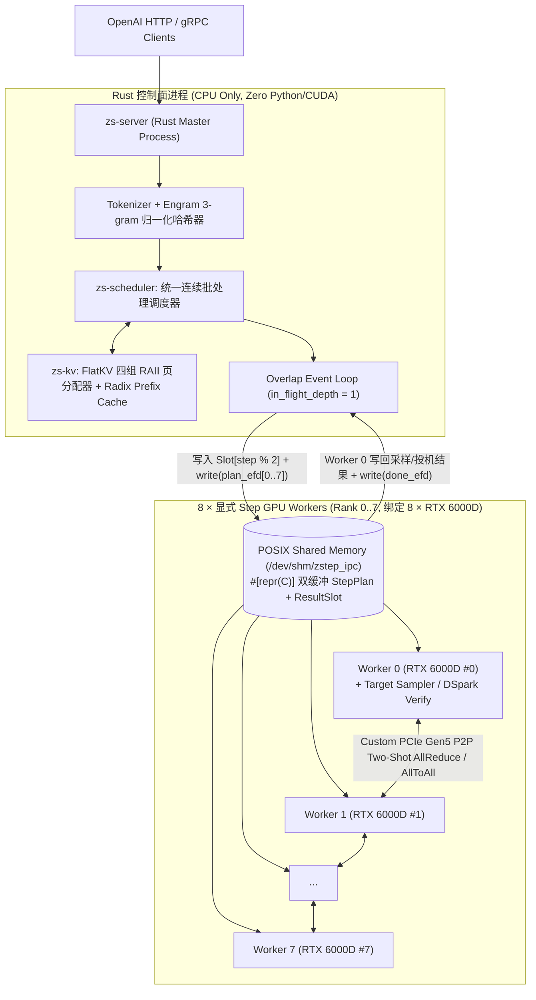
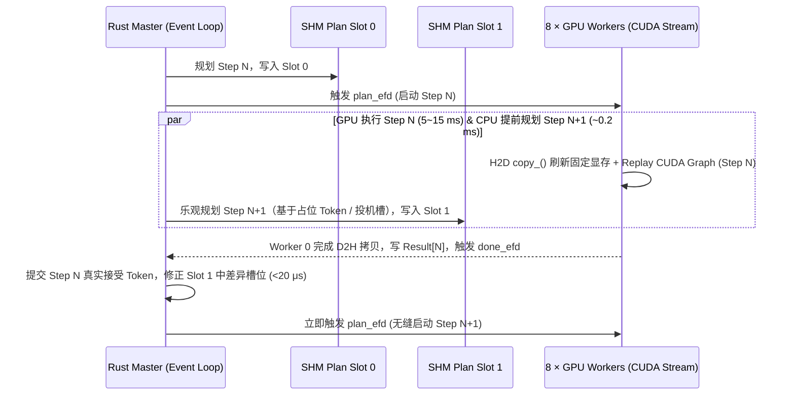

# 02 — `zstep` 系统架构设计文档

`zstep` 的核心设计哲学只有两条：
1. **严格的控制面与数据面物理隔离（Control / Data Plane Split）**：控制面 100% 由纯 Rust 编写，利用类型系统与 RAII 保证请求状态机、多组页表分配和流式输出的绝对确定性；数据面 100% 专注于 GPU 固定缓冲区刷新与算子/CUDA Graph 发射。
2. **唯一执行路径与显式 Step 结构（Unified Explicit Step Path）**：拒绝深层面向对象继承与隐式全局上下文；模型前向、KV 页地址、窄化视图与投机分支全部表示为扁平、显式维度的结构体，Prefill / Decode / Speculative Verify 共享同一套元数据刷新契约。

---

## 一、 整体拓扑架构（模式 B：单主控 + 8 Worker 共享内存 IPC）



### 为什么单机 `8 × RTX 6000D` 不需要分布式多调度器？
单台 8 卡服务器内的 8 张 GPU 共享同一个操作系统内核、同一个 `/dev/shm` tmpfs 页缓存以及微秒级 `eventfd` 内核通知。由 **1 个 Rust 主控进程** 集中完成以下所有 CPU 工作：
* 请求准入校验、Tokenizer 编解码、`xgrammar` 约束掩码生成；
* **Engram 3-gram 窗口追踪与哈希预计算**（直接写入共享内存输入槽，8 个 Worker 免重复计算）；
* **FlatKV 四组页表统一分配与前缀匹配**（全局唯一真值源，杜绝跨 Rank 页号失步）；
* **CED 窄化行数预算与分桶对齐**（主控直接算出 `encoder_padded_rows` 与 `decoder_padded_rows` 两个 CUDA Graph 桶大小，8 个 Worker 盲执同一桶号即可保证集体通信严格对齐）。

---

## 二、 核心子系统设计

### 1. 双缓冲重叠事件循环（`in_flight_depth = 1` Overlap Loop）
为了彻底消除 CPU 调度、Tokenizer、Engram 哈希与跨进程唤醒的耗时，`zstep` 采用深度为 1 的双缓冲流水线：



* **控制面铁律**：主控线程绝不轮询忙等（Busy-wait），仅阻塞在 `epoll`（同时监听新网络请求到达与 `done_efd` 完成事件），保证空载 0% CPU 占用、满载微秒级响应。

### 2. `zs-kv`：面向 `DeepSeek-V4.1-Flash` 的四组异构缓存与 RAII 生命周期
不同于传统引擎单一均匀的 KV Block Pool，`zs-kv` 原生将每个请求的缓存建模为 **Cache Group 集合**，并通过 Rust RAII 句柄 `BlockLease` 绑定生命周期（请求被抢占、取消或出错 Drop 时自动归还物理页，零泄漏）：

| 缓存组 ID | 物理页布局（每页 64 行） | `sm_120` 存储格式 | Prefix Cache 策略 | 生命周期特征 |
| :--- | :--- | :--- | :--- | :--- |
| **Group 0: `GlobalKV`** | `uint8 [P, 64, 288]` | 512D **NVFP4** (`E2M1` + `E4M3`/16) | **参与** Radix 前缀复用 | 随上下文线性增长，跨请求只读共享（COW） |
| **Group 1: `IndexKey`** | `uint8 [P, 64, 68]` | 128D **MXFP4** (`E2M1` + `E8M0`/32) | **参与** Radix 前缀复用 | 与 `GlobalKV` 同步分配，供稀疏选块打分 |
| **Group 2: `SwaWindow`** | `uint8 [P, 64, 528]` (+ DSpark BF16 视图) | 512D **MXFP8** (`E4M3` + `E8M0`/32) | **不进前缀池（Replayable）** | 环形覆盖，每个请求固定最多持有 3 页（覆盖 128 窗口 + 投机步） |
| **Group 3: `CompressorTail`** | 压缩状态尾槽 | 模型指定紧凑精度 | **不进前缀池（Replayable）** | 请求私有定长槽位，随请求释放立即回收 |

* **SWA 有界重放（Bounded Replay）**：当新请求在 Radix Tree 命中长度为 $L$ 的缓存前缀时，`zs-scheduler` 自动将有效命中前缀回退 $\min(L, 128)$ 个 Token，并在 `StepPlan` 中标记这些重放行的 `replay_mask = 1`——使第 0~20 层为该请求重新生成私有的 `SwaWindow` 与 `CompressorTail`，同时屏蔽对共享 `GlobalKV` / `IndexKey` 页的重复写入。

### 3. 数据面显式四阶段前向与分段 CUDA Graph
在 `worker/zstep_worker/models/deepseek_v41.py` 中，完全摒弃多层 Wrapper，每个 Worker 进程启动时预分配**地址永久不变的静态输入/中间张量池（Static Device Workspace）**，并将 `DeepSeek-V4.1-Flash` 明确组织为四个显式阶段：

1. **`stage1_encoder(ws, bucket_enc_tokens)`**（Layers 0..19）：
   * 输入行数 `T_enc`（所有 Chunked Prefill Token + 所有 Decode/Verify Token）。
   * 包含 Embedding、Engram 查表融合、mHC 残差混合、FlatKV / SelectedAttention、384 专家 MXFP4 MoE + PCIe AllReduce。
   * **捕获为按 `T_enc` 分桶的 `EncoderCudaGraph`**。
2. **`stage2_narrowing(ws)`**（Layer 20 — Candidate Source）：
   * 对全量 `T_enc` 行写出 Decoder 所需的全局 KV 与候选索引，随后按调度器预先算好的 `narrow_keep_indices` 索引收集保留行（每个未完成 Prefill 请求仅留 1 行，已完成末尾 Chunk 留最后 128 行，Decode/DSpark 留全部行），输出窄化后的 `T_dec` 行。
   * 保持轻量急切执行（仅涉及索引切分与单个候选层过渡）。
3. **`stage3_decoder(ws, bucket_dec_rows)`**（Layers 21..39 + Final RMSNorm）：
   * 仅在窄化后的 `T_dec` 行（上限 `max_seqs × 128`）上运行后半段 MoE 与稀疏注意力，节省大量 Prefill 算力。
   * **捕获为按 `T_dec` 分桶的 `DecoderCudaGraph`**（纯 Decode / DSpark Verify 步则可将 Stage 1~4 合并捕获为单一整图 `DecodeVerifyGraph`，实现单步零中断发射！）。
4. **`stage4_sample_and_dspark(ws)`**：
   * 屏蔽非法控制 Token（`0, 2, 129262..129264`），执行目标采样 / DSpark 6-token 树/链验证，并就地运行同检查点 DSpark Drafter 生成下一轮的 5 个草稿候选（凑齐下一轮 6 个验证行）。

---

## 三、 实测硬件拓扑约束与目标档位边界（Verified `8 × 32 GB` vs Unverified `84 GB / 96 GB`）

### 1. 当前实测工作站的非对称 4-NUMA PCIe 拓扑（Verified `8 × 32 GB sm_120`）
所有已归档基准数据均在同一台 `8 × 32 GB sm_120` 机器上实测，其真实 PCIe / NUMA 拓扑如下：

```text
  GPU 0, 1, 2 -> PCIe Switch A, NUMA 0 (同节点 NODE 互联)
  GPU 3       -> 独立根复合体,   NUMA 1 (跨全部对端均为 SYS)
  GPU 4, 5, 6 -> PCIe Switch B, NUMA 2 (同节点 NODE 互联)
  GPU 7       -> 独立根复合体,   NUMA 3 (跨全部对端均为 SYS)
  无 NVLink；8×8 can_device_access_peer 矩阵全为 0
```

这带来三条直接的工程约束（已在代码中固化）：
1. **硬件验证边界区分**：
   * **Verified (`8 × 32 GB`)**：完整验证算子形状/吞吐、`zs-shm` 协议、双缓冲重叠、Radix 前缀缓存，以及 **`Qwen3.5-35B-A3B` (`67 GB` BF16, `~8.4 GB/GPU`)** 真权重端到端并发服务；
   * **Unverified (`84 GB RTX 6000D` 中国特供版 / `96 GB RTX PRO 6000` 国际版)**：`510 GB` 满血 `DeepSeek-V4.1-Flash`（`63.75 GB/GPU`）在 `8 × 32 GB` 上无法端到端装入显存，所有大显存池几何通过 `ShmGeometry::from_vram_budget` 按设备实测显存动态推导，不硬编码未验证卡型的容量魔数。
2. **Worker NUMA 亲和绑定与 First-Touch 分页**：
   * [`WorkerSlotState`](../crates/zs-wire/src/lib.rs) 显式记录每个 Worker 的 `numa_node`；[`numa_pin.py`](../worker/zstep_worker/numa_pin.py) 在进程触碰共享内存或初始化 CUDA 前读取 `/sys/bus/pci/devices/<bdf>/numa_node` 并将进程绑定至本地 NUMA CPU 核；
   * [`HostMappedShmAllReduce`](../worker/zstep_worker/kernels_sm120/shm_allreduce.py) 将每卡槽位对齐到 `4 KiB` 页边界，由各 Rank 从本地 NUMA 线程独立执行 First-Touch 缺页分配，避免 `GPU 4..7` 跨 UPI 访问落在 `NUMA 0` 上的物理页。
3. **非 P2P 拓扑下的 AllReduce 物理上限与对比口径**：
   * 在 `can_device_access_peer = 0` 的拓扑上，NCCL 只能回退至 **降级版 Host-SHM 传输路径**（并非有 P2P / NVLink 机器上的真实 NCCL 水平），因此所有对比结论严格限定于 **无 P2P 的多 NUMA PCIe 拓扑**，不可外推至具备 P2P BAR1 的平台；
   * 自研 Two-Shot 规约每卡流量为 `1.125× N` 写 + `2.0× N` 读（8 卡聚合穿过主机内存约 `25× N`），大包受限于主机内存聚合带宽墙（`~170–200 GB/s`），进一步提速应依赖减少跨卡同步次数与跨层重叠，而非继续微调单次内核。

### 2. 已在 `sm_120` 上锁定的算子与并行结论
1. **384 专家 MXFP4 MoE 采用 `TP=8`（`intermediate=288`/卡）而非 `EP=8`**：
   * 在 `TP=8` 与 Replicated-Input `EP=8` 同样仅需层末 **1 次 AllReduce**（均无 AllToAll）的前提下，`TP=8` 让 8 张卡协同分摊每个激活专家的权重读取：
     * `M=6`：**`70.24 µs`**（`TP=8`）vs **`320.55 µs`**（`EP=8`），**快 `4.56×`**；
     * `M=48`：**`435.07 µs`** vs `574.19 µs`（**快 `1.32×`**）；
     * `M=4096`：**`2414.73 µs`** vs `8865.44 µs`（**快 `3.67×`**）。
2. **Engram 混合驻留策略（VRAM Sharded vs Host Pinned UVA）**：
   * 实测第 `(1, 14)` 层 TP8 分片（每层单卡 `12.29 GB`）：VRAM 分片单层仅 **`4.1~4.4 µs`**；Host Pinned UVA 零拷贝在 `M=6` 下单层仅 **`6.12 µs`**。
3. **热重载调试通道（`zstep reload-worker`）**：
   * Worker 将权重持有在独立的 `WeightStore` 模块中，收到主控的 `RELOAD_FORWARD` 控制指令时，仅重载算子与前向模块并重录 CUDA Graph。
