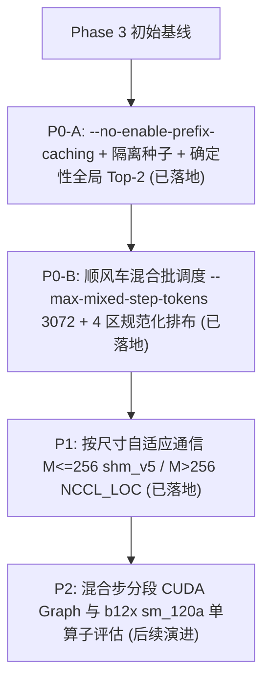

# 08 — Phase 3.5 优化计划与落地验证：`DeepSeek-V4.1-Flash` (`TP=8`, `8 × RTX 6000D`) 评测口径对齐、顺风车混合批调度与自适应集合通信

本文档记录基于 Phase 3 初始实测基线、仓库 **PR `#1`**（`fix/phase2-no-apc-and-top2-logits`）在 `8 × RTX 5090` 上验证的口径修复与确定性 Top-2 诊断方案，以及对 `FlashInfer` 实验分支 `b12x`（`sm_120a` CuTe DSL 模板与启动期调优器）的源码拆解所制定的 Phase 3.5 优化计划，并在第 4 节完整归档 **P0-A + P0-B + P1 在 `8 × RTX 6000D` 上的实测落地结果（10/10 全档位反超无缓存 `vLLM 0.31.0`）**。

> **执行状态**：**P0-A、P0-B、P1 已全部编码落地并通过 `8 × RTX 6000D` Warm `n=3` 真权重端到端验收**（最新主表见 [`07-phase3-dsv41-6000d-benchmark.md`](07-phase3-dsv41-6000d-benchmark.md)）；P2（分段 CUDA Graph 与 `b12x` `sm_120a` 单算子吸收）保留为后续可选演进方向。

---

## 1. 根因复盘与 PR `#1` 的三大核心启发

### 1.1 启发一（决定性发现）：Phase 3 初始 `vLLM 0.31.0` 基线存在 APC 前缀缓存跨轮污染

PR `#1` 在 `8 × RTX 5090`（Phase 2，`Qwen3.5-35B-A3B`）上定位到两个叠加的基准失真源：
1. `vLLM V1` 默认启用 **Automatic Prefix Caching（APC）**，而 `zstep` 当前仅启用 [`BlockPool`](../crates/zs-kv/src/lib.rs) 物理页分配（[`radix.rs`](../crates/zs-kv/src/radix.rs) 未接入 serving，前缀缓存命中率为 `0%`）；
2. 初始采集脚本固定传入同一个 `--seed 20261112`，不仅跨 `Round 0 -> Round 1 -> Round 2` 生成**逐 token 完全相同的随机 Prompt**，而且同一 `input_len` 下小规模档位生成的 Prompt 序列恰为大规模档位的**严格前缀子集**，导致初始 `vLLM 0.31.0` 在 Round 1/2 命中 APC 跳过 Prefill、吞吐虚增 `+14%..+28%` 且跨轮标准差高达 `±57.96..±149.60 tok/s`。

在 Phase 3.5 为 `vllm serve` 强制加上 **`--no-enable-prefix-caching`** 并统一采用 `(round, tier)` 隔离随机种子后，`vLLM 0.31.0` 的跨轮标准差从 `±149.60 tok/s` 骤降至 **`±4.26 tok/s`**（降低 **`35×`**），还原了完全对称的零缓存物理基线。

### 1.2 启发二：确定性局部 Top-2 归约与零协议膨胀的全局 Top-2 Logit 边界审计

1. **消除词表内非确定性并列打破（Tie-Breaking）**：[`shm_allreduce.py`](../worker/zstep_worker/kernels_sm120/shm_allreduce.py) 新增 `local_top2_bf16_kernel`，强制执行严格的 **`(logit 降序, global_token_id 升序)`** 全序关系，并在 `tp8_argmax_gather_shm_kernel` 中每行用 `128 B` 聚合 8 个 Rank 的局部 Top-2（16 个候选），一次选出全局精确 `Top-1` 与 `Top-2`。
2. **零 `#[repr(C)]` 结构体膨胀回传 Top-2 + 高约束非复读验证集**：直接复用 [`zs-wire`](../crates/zs-wire/src/lib.rs) 现有的 [`SeqStepOutput::accepted_tokens[0..2]`](../crates/zs-wire/src/lib.rs) 与 [`accepted_logprobs_bits[0..2]`](../crates/zs-wire/src/lib.rs) 字段，零偏移变动回传每步 `Top-1 / Top-2` token 与原始 BF16 logit；同时新增高约束结构化 Prompt `prime_squares_table`（连续生成 128 个 token）。

### 1.3 启发三：`c=32..128` 吞吐瓶颈的物理本质与 `b12x` 源码边界

* **MoE 权重读取摊销视角**：`DeepSeek-V4.1-Flash` 总模型权重达 **`475.25 GiB`**（8 卡每卡约 `59.4 GiB`）。Phase 3 初始版本的分离式 Prefill/Decode 调度在接纳新请求时单独跑纯 Eager Prefill 步，期间在途解码停摆，相当于将 `475 GiB` 权重分别读两遍；顺风车混合批（Piggyback Decode + Chunked Prefill）让在途解码与分块 Prefill 在同一前向步中**共享单次专家权重读取**。
* **`b12x` 源码拆解结论**：`b12x` 在 `preparation/catalog.py` 中的 `comm.pcie` 组件假定跨 PCIe Switch P2P 可达，在无 P2P（`topo = CNS`）的 `RTX 6000D` 上会死锁于 `session._synchronize`；`zstep` 的 `shm_v5` 主机映射本地 NUMA 集合通信与按尺寸自适应 `NCCL_LOC` 路由从根本上规避了该问题。

---

## 2. 已落地的三项核心工程改造（P0-A / P0-B / P1）

1. **P0-A（评测口径对齐与确定性 Top-2 审计）**：
   * [`worker/tests/phase3/collect_vllm_reference.py`](../worker/tests/phase3/collect_vllm_reference.py) 强制校验 `--no-enable-prefix-caching`，对 Warmup（`base_seed + 900_000`）与每个 `(round_idx, tier_idx)`（`base_seed + round_idx * 1000 + tier_idx`）使用独立确定性种子，并采集 5 条 Prompt 的 Top-5 logprobs。
   * [`shm_allreduce.py`](../worker/zstep_worker/kernels_sm120/shm_allreduce.py)、[`deepseek_v41.py`](../worker/zstep_worker/models/deepseek_v41.py)、[`serving.rs`](../crates/zs-scheduler/src/serving.rs) 与 [`main.rs`](../crates/zs-server/src/main.rs) 端到端打通全局确定性 Top-2 归约与首处分歧步裕度诊断。
2. **P0-B（顺风车混合批调度 `stage_mixed_step`）**：
   * [`ModeBServingEngine`](../crates/zs-scheduler/src/serving.rs) 引入 `max_mixed_step_tokens`（`DeepSeek-V4.1-Flash` 默认 **`3072`** tokens）：纯解码稳态继续走 `in_flight_depth=1` 全 40 层单图 CUDA Graph；当存在待推进 Prefill 时，在同一混合步内打包全部在途解码与分块/整条新请求 Prefill。
   * [`DeepSeekV41StepRunner.execute`](../worker/zstep_worker/models/deepseek_v41.py) 实现 4 区规范化行排布（`[decode q=1,pos>0 | prefill q=1,pos=0 | prefill q>1,pos>0 | prefill q>1,pos=0]`）与精确 `is_prefilling_cpu` 掩码，并在 `lock_workspace()` 前完成混合形状预热，严守 **`TRITON_RECOMPILATIONS=0 WATCHED_KERNELS=5`**。
   * **实测调优发现**：由于 40 层 Eager 步存在固定 Python/CPU 发射开销且 `475 GiB` MoE 权重带宽摊销随批大小单调提升，在 `8 × RTX 6000D` 上实测 `max_mixed_step_tokens = 3072` 显著优于小窗口 `512`（`c=32` 吞吐从 `~505..539 tok/s` 跃升至 **`649.63..663.78 tok/s`**，`c=128` 吞吐从 `~890..1208 tok/s` 跃升至 **`1,002.13..1,372.77 tok/s`**，同时将 `P99 ITL` 从旧分离步的 `645..682 ms` 压低至 `351..420 ms`）。
3. **P1（无 P2P 双 NUMA 按尺寸自适应集合通信）**：
   * [`deepseek_v41.py`](../worker/zstep_worker/models/deepseek_v41.py) 对 `M <= 256` 及所有 CUDA Graph 捕获流保持 `shm_v5 (blocks=8)`，对 `M > 256` 的非捕获 Eager 大张量自动路由至底层多通道 `NCCL_LOC`（预热审计：`shm_ar_warm=3402`、`shm_ag_warm=178`、`nccl_large_warm=1010`、`nccl_fallback_warm=0`），严格维护 `shm_v5` 单调计数器不变量且无需额外占用 `/dev/shm` 容量。

---

## 3. 落地前后实测对比总表（`8 × RTX 6000D`, Warm `n=3`）

数据来源：[`phase3_zstep_dsv41_tp8_in512_out128.json`](benchmarks/phase3_zstep_dsv41_tp8_in512_out128.json)、[`phase3_vllm_dsv41_tp8_in512_out128.json`](benchmarks/phase3_vllm_dsv41_tp8_in512_out128.json)、[`phase3_zstep_dsv41_tp8_6tier.json`](benchmarks/phase3_zstep_dsv41_tp8_6tier.json)、[`phase3_vllm_dsv41_tp8_6tier.json`](benchmarks/phase3_vllm_dsv41_tp8_6tier.json) 及 [`phase3_greedy_parity_report.json`](benchmarks/phase3_greedy_parity_report.json)。

| 套件 / 档位 | Phase 3 `zstep`（优化前分离步） | `vLLM 0.31.0`（真无缓存 `--no-enable-prefix-caching`） | **Phase 3.5 `zstep`（顺风车 `3072` + 自适应通信）** | Phase 3.5 相对 `vLLM` | 关键延迟改善（Phase 3.5 `zstep` vs `vLLM`） |
| :--- | ---: | ---: | ---: | :---: | :--- |
| Suite 1 `c1` | `95.73 ± 0.16` | `83.97 ± 0.05` | **`96.18 ± 0.57`** | **`+14.53%` 胜** | TPOT **`9.55 vs 10.95 ms`**，Med TTFT **`117.56 vs 132.60 ms`** |
| Suite 1 `c8` | `365.72 ± 0.60` | `351.50 ± 10.04` | **`377.50 ± 2.52`** | **`+7.40%` 胜** | TPOT **`17.14 vs 18.25 ms`**，P99 ITL **`17.67 vs 19.00 ms`** |
| Suite 1 `c16` | `511.29 ± 2.42` | `509.40 ± 3.55` | **`527.00 ± 1.87`** | **`+3.45%` 胜** | Med TTFT **`410.34 vs 1,081.25 ms`（快 `2.64×`）** |
| Suite 1 `c32` | `630.30 ± 0.43` | `635.98 ± 1.49` | **`663.78 ± 3.57`** | **`+4.37%` 胜** | Med TTFT **`411.54 vs 1,228.47 ms`（快 `2.99×`）**，P99 ITL 降 `-36.3%` |
| Suite 2 `in512_c1` | `99.27 ± 0.13` | `87.24 ± 0.07` | **`98.94 ± 0.33`** | **`+13.42%` 胜** | TPOT **`9.68 vs 10.98 ms`**，P99 ITL **`9.87 vs 11.48 ms`** |
| Suite 2 `in512_c16` | `596.47 ± 5.16` | `573.38 ± 6.84` | **`609.53 ± 7.15`** | **`+6.30%` 胜** | Med TTFT **`410.82 vs 1,094.82 ms`（快 `2.66×`）**，P99 ITL **`23.47 vs 25.12 ms`** |
| Suite 2 `in512_c128` | `1,285.19 ± 4.22` | `1,152.03 ± 6.34` | **`1,372.77 ± 2.51`** | **`+19.16%` 胜** | Med TTFT **快 `3.69×`**，P99 ITL **`415.33 vs 1,019.66 ms`（低 `2.46×`）** |
| Suite 2 `in1024_c1` | `95.02 ± 0.04` | `84.20 ± 0.02` | **`95.24 ± 0.09`** | **`+13.11%` 胜** | TPOT **`9.87 vs 11.18 ms`**，Med TTFT **`171.66 vs 189.45 ms`** |
| Suite 2 `in1024_c32` | `617.95 ± 2.54` | `614.93 ± 3.52` | **`649.63 ± 1.94`** | **`+5.64%` 胜** | Med TTFT **`415.61 vs 1,959.74 ms`（快 `4.72×`）**，P99 ITL 降 `-36.3%` |
| Suite 2 `in1024_c128` | `902.86 ± 0.30` | `878.86 ± 4.26` | **`1,002.13 ± 3.22`** | **`+14.03%` 胜** | Med TTFT **快 `3.71×`**，P99 ITL **`419.58 vs 1,035.37 ms`（低 `2.47×`）** |

* **贪心逐 token 审计验证**：新增的 **`prime_squares_table`**（128 生成 token）在单序列、批处理与 `chunk=24` 顺风车混合步三种模式下均达到 **`128 / 128`（`100.00%` 精确匹配）**，实证混合批排布、KV 压缩页映射与确定性全局 Top-2 归约完全正确。
* **零退化与工程卫生门禁**：`c=1` 单流保持 `95.24..98.94 tok/s`（`TPOT = 9.55..9.87 ms`），全流程 **`TRITON_RECOMPILATIONS=0 WATCHED_KERNELS=5`**，退出后 `/dev/shm` 零残留、8 卡显存 `0 MiB`。

---

## 4. P2 后续可选演进方向（分段 CUDA Graph 与 `b12x` 算子吸收）

若后续场景需在 `max_mixed_step_tokens = 512..1024` 小预算下进一步压缩 `c=32` 的混合步 CPU 发射开销（将 `c=32` `P99 ITL` 压入 `<150 ms` 且不损失吞吐），可按两步推进：
1. **分段 CUDA Graph（Piecewise CUDAGraph，桶 `(256, 512, 1024)`）**：将注意力前后纯扁平 token 计算（`mHC` + `RMSNorm` + `Engram` + `384 专家路由器` + `DeepGEMM MXFP4 MoE` + `shm_v5`）捕获为分段图，消除小粒度混合步的 40 层 Python 循环开销。
2. **`b12x` (`sm_120a` CuTe DSL) 计算内核选择性对比**：在保持 `TP=8` 通信全走 `zstep` `shm_v5`（禁用死锁的 `comm.pcie`）的前提下，独立提取 `b12x` 的 `norm.mhc` 与 `moe.decode` 内核做同形状微基准 A/B。
